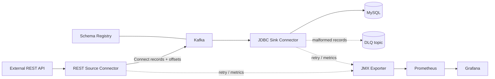

# Kafka Connect Toolkit

[](https://github.com/sajuu730/kafka-connect-toolkit/actions/workflows/ci.yml)
[](https://openjdk.org/projects/jdk/17/)
[](https://kafka.apache.org/)

A Java 17 multi-module project demonstrating custom Kafka Connect integrations: an HTTP REST source connector and a JDBC sink connector, supported by retry primitives, containerized infrastructure, and an observability stack.

> **Project status: Active development.** The latest GitHub Actions run completed successfully: Maven verification and the end-to-end smoke-test job both passed. This validates the scenarios exercised by the CI workflow; it is not a production-readiness certification. The REST source checkpoint contract remains limited to stable, monotonically ascending IDs.

## Highlights

- Custom REST source and JDBC sink connectors built on the Kafka Connect APIs.
- Incremental source checkpointing using Kafka Connect offsets.
- Bounded retries, exponential backoff, jitter, and HTTP `Retry-After` handling.
- JDBC batching, transactions, and MySQL upsert support.
- Malformed-record reporting through Kafka Connect's `ErrantRecordReporter`.
- Docker Compose environment with Kafka, Schema Registry, Kafka Connect, MySQL, Prometheus, JMX Exporter, and Grafana.
- CI verification plus a Docker-based end-to-end smoke test.

## Architecture



## Implemented connectors

### REST source

- Java `HttpClient` polling with bounded connect/request timeouts.
- JSON object/array decoding and page-number pagination with a maximum-page guard.
- Converts JSON objects into typed Kafka Connect `Struct` values; primitive scalar types are retained, while nested objects/arrays are compact JSON strings.
- Emits stable record IDs as Kafka Connect source offsets and reads saved offsets on task startup.
- Filters records at or below the last committed ID (numeric comparison when possible, lexical otherwise).
- Optional incremental cursor query parameter for APIs that accept the last committed ID.
- Capped exponential retry with jitter for transient HTTP and I/O failures.
- HTTP 429/503 handling honors `Retry-After` delta-seconds or HTTP-date values, bounded to five minutes.
- Optional bearer-token authentication.

**REST source limitations:** checkpointing assumes stable, unique, monotonically ascending IDs. Opaque cursors, arbitrary next-page links/tokens, compound keys, and out-of-order APIs are not supported. Configure the cursor query parameter only when the remote API accepts the last ID as its cursor.

### JDBC sink

- Writes Kafka Connect `Struct` records with prepared statements.
- Configurable JDBC batching and transaction-per-`put` behavior.
- MySQL `INSERT ... ON DUPLICATE KEY UPDATE` upsert path.
- PostgreSQL/H2-compatible `ON CONFLICT` path retained for tests.
- Bounded retry for transient SQL execution errors; ambiguous commit failures fail the task rather than retrying blindly.
- Additive-only schema evolution adds nullable columns for newly observed fields; existing column types are not altered.
- Uses `ErrantRecordReporter` for malformed non-Struct/empty records when the worker supplies a DLQ reporter.

**JDBC sink limitations:** schema evolution is additive-only and database-specific DDL must be reviewed before production use. Schema/DDL failures are infrastructure failures and fail the task. Configure sink connector-level `errors.tolerance=all` and `errors.deadletterqueue.topic.name` to enable routing through the worker reporter.

## Technology

Java 17 · Apache Kafka Connect 3.8.1 · Avro/Schema Registry · Maven · JUnit 5 · Testcontainers · MySQL 8.4 · Docker Compose · Prometheus · Grafana

## Repository layout

```text
common/                         shared retry and metrics utilities
connectors/rest-source/         HTTP to Kafka source connector
connectors/jdbc-sink/           Kafka to JDBC sink connector
config/                         local database initialization
monitoring/                     JMX exporter, Prometheus and Grafana provisioning
docs/                           architecture and operations
scripts/                        end-to-end smoke-test harness
docker-compose.yml              local infrastructure stack
```

## Quick start

Requirements: JDK 17+, Maven 3.9+, Docker Engine, and Docker Compose plugin.

```bash
mvn --batch-mode clean package
docker compose up -d
docker compose ps
curl http://localhost:8083/connector-plugins
```

Local endpoints:

| Service | Local address |
|---|---|
| Kafka | `localhost:9092` |
| Schema Registry | `http://localhost:8081` |
| Kafka Connect REST | `http://localhost:8083` |
| MySQL | `localhost:3306` (database: `connect_demo`) |
| Prometheus | `http://localhost:9090` |
| Grafana | `http://localhost:3000` |
| JMX Exporter | `http://localhost:5556/metrics` |

The Compose stack uses plaintext listeners and demo credentials and is intended for local development only. Build the connector JARs before starting Kafka Connect because the worker mounts module `target/` directories.

## MySQL sink configuration example

```json
{
  "name": "mysql-events-sink",
  "config": {
    "connector.class": "io.github.sajuu730.connect.jdbc.JdbcSinkConnector",
    "tasks.max": "1",
    "connection.url": "jdbc:mysql://mysql:3306/connect_demo",
    "connection.user": "connect",
    "connection.password": "connect_local_only",
    "table.name": "events",
    "insert.mode": "upsert",
    "pk.fields": "id",
    "batch.size": "500"
  }
}
```

The local password is demonstrative and must never be reused in a deployed environment. Configure production credentials through a Kafka Connect ConfigProvider or secret manager.

## Reliability semantics

- Kafka Connect owns durable source offset commits; the connector emits an ID offset with each source record.
- Sink writes are grouped into JDBC transactions for each `put` call.
- SQL execution retry is limited to recognized transient failures.
- A failed commit has an ambiguous outcome and is surfaced as a task failure.
- Malformed-record reporting uses the worker-provided `ErrantRecordReporter`; configure `errors.tolerance=all` and `errors.deadletterqueue.topic.name` on the sink connector for routing.
- Delivery should be treated as **at-least-once**. Design keys and upsert semantics for idempotency; no end-to-end exactly-once guarantee is claimed.

## CI and verification

The GitHub Actions workflow runs:
1. Maven verification, including the configured test suite.
2. Docker Compose end-to-end smoke tests covering the REST-to-MySQL path and the failure/recovery/monitoring scenarios encoded in the script.

[View the latest successful CI run](https://github.com/sajuu730/kafka-connect-toolkit/actions).

To run locally:

```bash
mvn --batch-mode verify
docker compose up -d
bash scripts/e2e-smoke.sh
```

## Roadmap

- [x] Java 17 Maven modules and shared bounded retry policy
- [x] REST polling, bearer auth, page-number pagination and source offsets
- [x] Stable ascending-ID checkpoint filtering and optional query cursor parameter
- [x] JDBC batching, transactions, MySQL upsert, and additive nullable-column evolution
- [x] Kafka, Schema Registry, Kafka Connect, MySQL, Prometheus, JMX Exporter and Grafana local stack
- [x] DLQ reporting and end-to-end smoke-test coverage for the scenarios currently encoded in CI
- [ ] Opaque API cursors, next-page tokens, compound keys and strict ordering guarantees
- [ ] Broader database dialect coverage and schema-evolution fault tests
- [ ] Validate metric scrape and dashboard queries against a separately managed live stack

## Production considerations

Do not deploy local Compose credentials or plaintext listeners to production. Use TLS/SASL, secret/config providers, replicated internal Connect topics, suitable replication factors, monitored DLQ retention, and an appropriate database connection policy. This project is an engineering demonstration under active development, not a certified production distribution.

## Documentation

- [Architecture](docs/architecture.md)
- [Operations guide](docs/operations.md)
- [Contributing](CONTRIBUTING.md)
