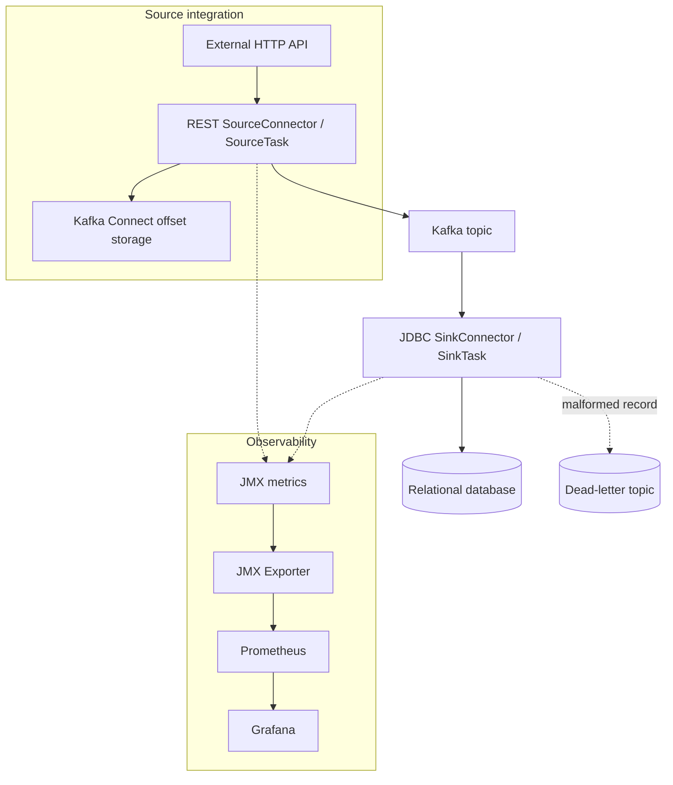

# Architecture

## System overview

## Module boundaries

- `connect-common`: reusable retry policy and cross-connector primitives.
- `rest-source-connector`: Kafka Connect source integration for HTTP APIs. JSON objects become typed Connect `Struct` values so schema-aware converters can serialize them.
- `jdbc-sink-connector`: Kafka Connect sink integration for relational databases, with batched prepared statements, additive nullable-column evolution and idempotent upsert modes.

Each connector owns its configuration, task lifecycle, and external-system interaction. Shared code remains independent of connector-specific configuration.

## Reliability model

The toolkit distinguishes transport retries from Kafka delivery semantics. A successful HTTP response is not, by itself, proof that downstream records have been committed by Kafka. Source offsets are committed by the Connect runtime. Sink writes can be replayed after task restart; database-side idempotency therefore depends on the configured write strategy and target schema.

No exactly-once claim is made for arbitrary HTTP APIs or JDBC targets. Delivery is **at-least-once**: source records can be replayed around offset commits and sink records can be replayed around task/commit failures. Database upserts with stable keys reduce duplicate effects but do not make the entire pipeline exactly-once.

The source checkpoint currently assumes stable monotonically ascending record IDs. The optional query cursor parameter forwards the last committed ID to APIs that support that convention; opaque next-page tokens and arbitrary cursor contracts are not implemented. The sink reports malformed individual records through the worker-provided `ErrantRecordReporter`; infrastructure failures remain task failures so valid records are not silently discarded.

## End-to-end validation

The Docker Compose E2E harness exercises the REST → Kafka/Avro/Schema Registry → MySQL path, malformed-record DLQ routing, source-offset persistence, a second-worker rebalance, Connect worker restart, sink-task recovery after a simulated MySQL outage, and the JMX/Prometheus/Grafana path. The latest CI workflow run passed both the Maven verification job and the end-to-end job. This confirms the checks encoded in the current workflow; a separately managed production-like environment still requires validation.

## Operational requirements

Connector implementations should validate configuration before task startup, bound network and database operations, close resources on stop, expose actionable errors, and avoid logging credentials or record payloads by default.
